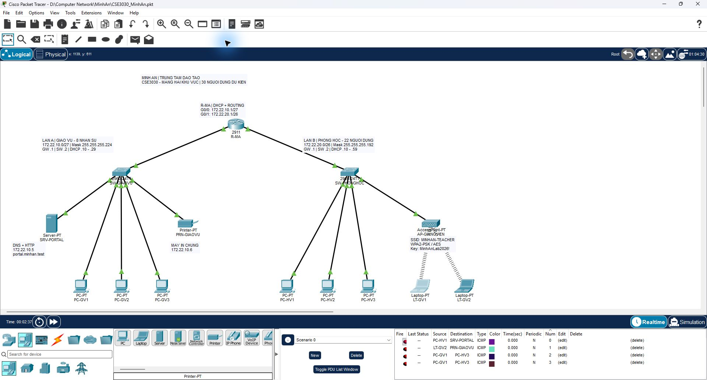
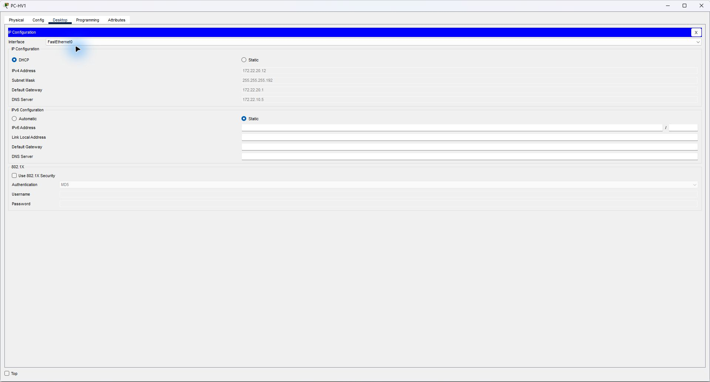
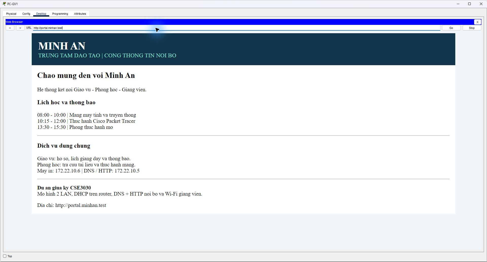
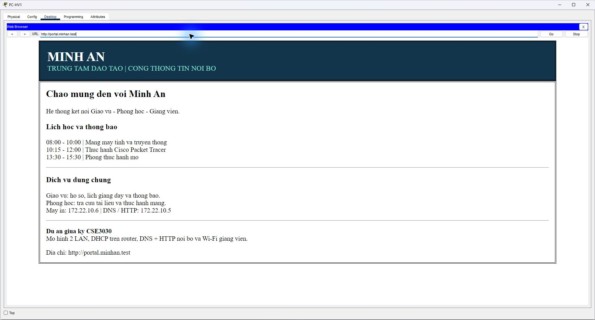
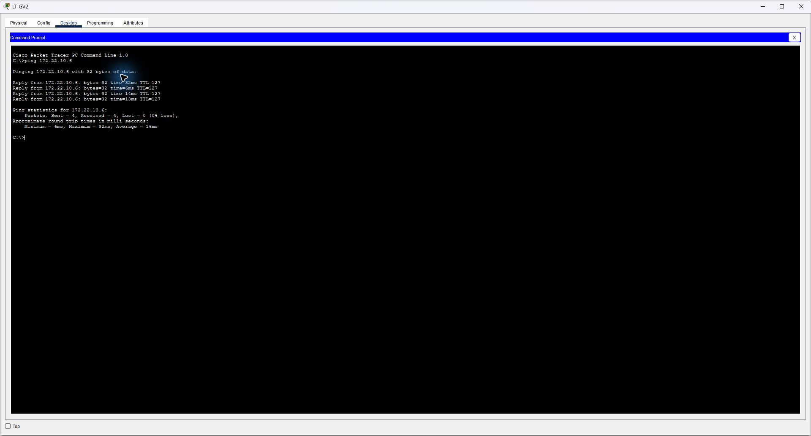
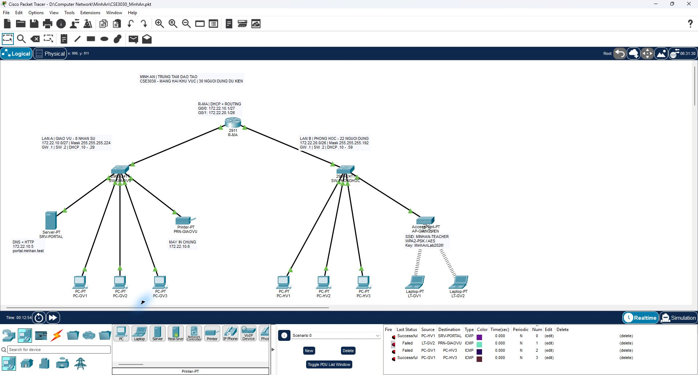
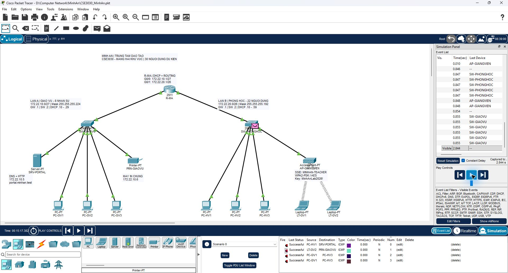

# Thiết kế mạng trung tâm đào tạo Minh An (Cisco Packet Tracer)

[](https://www.netacad.com/courses/packet-tracer)
[]()

Dự án thiết kế và mô phỏng hệ thống mạng cho **Trung tâm Đào tạo Minh An** trên Cisco Packet Tracer.

---

## 1. Tổng quan & Ý tưởng thiết kế

Trung tâm Minh An có quy mô ~30 người dùng được chia thành 2 khu vực mạng:
* **Khu Giáo vụ (LAN A):** ~8 nhân sự, quản lý hồ sơ, lịch học, thông báo nội bộ và máy in dùng chung.
* **Khu Phòng học (LAN B):** ~22 người dùng (học viên và giảng viên), truy cập cổng thông tin nội bộ và tài liệu học tập. Giảng viên kết nối không dây (Wi-Fi).

**Các đặc điểm kỹ thuật:**
* 2 Subnet mạng riêng biệt nối trực tiếp qua Router Cisco 2911.
* Cấp phát IP tự động qua Router DHCP Server cho cả 2 khu vực mạng.
* Máy chủ nội bộ `SRV-PORTAL` cung cấp dịch vụ phân giải tên miền (DNS) và cổng thông tin Web (HTTP) tại địa chỉ `http://portal.minhan.test`.
* Mạng không dây Wi-Fi bảo mật chuẩn WPA2-PSK/AES cho Giảng viên.
* Máy in mạng dùng chung có địa chỉ IP tĩnh đặt tại khu Giáo vụ, toàn bộ học viên và giảng viên từ LAN B đều có thể liên lạc.

---

## 2. Sơ đồ mạng & Danh mục thiết bị



### Sơ đồ nguyên lý (Topology)

```text
                           R-MA (Router 2911)
                       G0/0                  G0/1
                         |                     |
                   SW-GIAOVU              SW-PHONGHOC
                  (Switch 2960)          (Switch 2960)
                   /    |    \              /        \
              3 PC  Server  Máy in       3 PC     AP-GIANGVIEN
                                                    )) ((
                                                  2 Laptop
```

### Danh mục thiết bị

| Thiết bị | Số lượng | Tên trên mô hình / Vai trò |
|---|:---:|---|
| **Router 2911** | 1 | `R-MA`: Gateway 2 LAN, định tuyến liên mạng & DHCP Server |
| **Switch 2960-24TT** | 2 | `SW-GIAOVU`, `SW-PHONGHOC`: Kết nối chuyển mạch Lớp 2 |
| **PC-PT** | 6 | `PC-GV1..3`, `PC-HV1..3`: Máy trạm làm việc của giáo vụ & học viên |
| **Server-PT** | 1 | `SRV-PORTAL`: Máy chủ DNS (`portal.minhan.test`) + Web HTTP |
| **Printer-PT** | 1 | `PRN-GIAOVU`: Máy in mạng dùng chung (`172.22.10.6`) |
| **AccessPoint-PT** | 1 | `AP-GIANGVIEN`: Điểm truy cập Wi-Fi nối vào LAN B |
| **Laptop-PT** | 2 | `LT-GV1`, `LT-GV2`: Laptop giảng viên (card WPC300N) |

### Bảng kết nối cổng cáp

| Đầu A | Đầu B | Loại cáp |
|---|---|---|
| `R-MA` G0/0 | `SW-GIAOVU` G0/1 | Cáp đồng thẳng (Copper straight-through) |
| `R-MA` G0/1 | `SW-PHONGHOC` G0/1 | Cáp đồng thẳng |
| `SW-GIAOVU` F0/1..3 | `PC-GV1..3` F0 | Cáp đồng thẳng |
| `SW-GIAOVU` F0/4 | `SRV-PORTAL` F0 | Cáp đồng thẳng |
| `SW-GIAOVU` F0/5 | `PRN-GIAOVU` F0 | Cáp đồng thẳng |
| `SW-PHONGHOC` F0/1..3 | `PC-HV1..3` F0 | Cáp đồng thẳng |
| `SW-PHONGHOC` F0/4 | `AP-GIANGVIEN` Port 0 | Cáp đồng thẳng |
| `AP-GIANGVIEN` Port 1 | `LT-GV1, LT-GV2` Wireless0 | Sóng Wi-Fi (WPA2-PSK) |

---

## 3. Kế hoạch địa chỉ IP (IPv4 Subnetting)

| Thông số | LAN A (Khu Giáo vụ) | LAN B (Khu Phòng học) |
|---|---|---|
| **Network Address** | `172.22.10.0/27` | `172.22.20.0/26` |
| **Subnet Mask** | `255.255.255.224` | `255.255.255.192` |
| **Dải IP khả dụng** | `172.22.10.1` - `172.22.10.30` | `172.22.20.1` - `172.22.20.62` |
| **Broadcast Address** | `172.22.10.31` | `172.22.20.63` |
| **Default Gateway** | `172.22.10.1` | `172.22.20.1` |
| **IP Quản trị Switch (VLAN 1)** | `172.22.10.2` | `172.22.20.2` |
| **Dải cấp DHCP** | `172.22.10.10` - `172.22.10.29` | `172.22.20.10` - `172.22.20.59` |
| **DNS Server** | `172.22.10.5` | `172.22.10.5` |

**Cấu hình IP Tĩnh:**
* `SRV-PORTAL`: `172.22.10.5/27` (Default Gateway: `172.22.10.1`)
* `PRN-GIAOVU`: `172.22.10.6/27` (Default Gateway: `172.22.10.1`)

---

## 4. Dịch vụ mạng & Cấu hình

* **DHCP Service:** Cấu hình trên Router `R-MA` với 2 pool `GIAOVU` và `PHONGHOC`, loại trừ các IP tĩnh và gateway.
* **DNS Service:** Domain Name `portal.minhan.test` trỏ về IP `172.22.10.5`.
* **Web Service (HTTP):** Giao diện thông báo nội bộ và lịch học của trung tâm Minh An.
* **Wi-Fi Giảng viên:** 
  * SSID: `MINHAN-TEACHER`
  * Bảo mật: `WPA2-PSK` (AES)
  * Mật khẩu: `MinhAnLab2026!`
* **Cấu hình Cisco IOS:** Toàn bộ lệnh chi tiết được lưu trong các file:
  * [R-MA.txt](R-MA.txt): Cấu hình Router (Interfaces, DHCP Pools, Services)
  * [SW-GIAOVU.txt](SW-GIAOVU.txt): Cấu hình Switch Giáo vụ
  * [SW-PHONGHOC.txt](SW-PHONGHOC.txt): Cấu hình Switch Phòng học

---

## 5. Kết quả kiểm thử & Minh chứng

| Thao tác kiểm thử | Mục đích | Minh chứng |
|---|---|:---:|
| **DHCP LAN B** | Kiểm tra cấp IP tự động trên PC-HV1 |  |
| **Web LAN A** | Truy cập `http://portal.minhan.test` từ PC Giáo vụ |  |
| **Web LAN B (Dây)** | Truy cập Web portal xuyên qua Router từ PC Học viên |  |
| **Web LAN B (Wi-Fi)**| Truy cập Web portal qua sóng Wi-Fi từ Laptop Giảng viên |  |
| **Ping Máy in** | Laptop Giảng viên ping thành công máy in `172.22.10.6` |  |
| **Liên lạc 2 LAN** | Gửi Simple PDU giữa PC Giáo vụ và PC Học viên |  |
| **Simulation Mode**| Kiểm tra gói tin ICMP di chuyển qua các switch và router |  |
| **Kiểm tra nạp lại** | Mở lại file pkt, kiểm tra dịch vụ duy trì ổn định |  |

---

## 6. Hướng dẫn sử dụng file mô phỏng

1. Mở file `CSE3030_MinhAn.pkt` bằng **Cisco Packet Tracer (v9.0 trở lên)**.
2. Đợi 10 - 20 giây (hoặc bấm nút **Fast Forward Time**) để quá trình hội tụ Spanning-Tree, kết nối Wi-Fi và xin cấp phát DHCP hoàn tất (tất cả các đèn chuyển sang màu xanh lá).
3. Mở bất kỳ PC hoặc Laptop nào, vào thẻ **Desktop > Web Browser**, gõ địa chỉ:
   ```text
   http://portal.minhan.test
   ```
4. Vào **Command Prompt** của thiết bị để thực hiện kiểm tra ping:
   ```bash
   ping 172.22.10.6    # Ping máy in
   ping 172.22.10.5    # Ping server
   ```
