# Thiết kế mạng trung tâm đào tạo Minh An (Cisco Packet Tracer)

[](https://www.netacad.com/courses/packet-tracer)
[]()
[]()

Dự án thiết kế và mô phỏng hệ thống mạng cho **Trung tâm Đào tạo Minh An** trên Cisco Packet Tracer.

---

## 1. Tổng quan & Ý tưởng thiết kế

Trung tâm Minh An có quy mô ~30 người dùng được chia thành 2 khu vực mạng:
* **Khu Giáo vụ (LAN A):** ~8 nhân sự, quản lý hồ sơ, lịch học, thông báo nội bộ và máy in dùng chung.
* **Khu Phòng học (LAN B):** ~22 người dùng (học viên và giảng viên), truy cập cổng thông tin nội bộ và tài liệu học tập. Giảng viên kết nối không dây (Wi-Fi).

**Các đặc điểm kỹ thuật:**
* 2 Subnet mạng riêng biệt nối trực tiếp qua Router Cisco 2911.
* Cấp phát IP tự động qua Router DHCP Server cho cả 2 khu vực mạng.
* Máy chủ nội bộ `SRV-PORTAL` cung cấp dịch vụ phân giải tên miền (DNS) và cổng thông tin Web (HTTP) tại địa chỉ `http://portal.minhan.test`.
* Mạng không dây Wi-Fi bảo mật chuẩn WPA2-PSK/AES cho Giảng viên.
* Máy in mạng dùng chung có địa chỉ IP tĩnh đặt tại khu Giáo vụ, toàn bộ học viên và giảng viên từ LAN B đều có thể liên lạc.

---

## 2. Tài khoản quản trị và danh mục file

**Đăng nhập thiết bị** (router và cả hai switch dùng chung, đặt `login local` trên console và VTY):

| Mục | Giá trị |
|---|---|
| Username | `admin` |
| Password | `MinhAn@Admin26` |
| Enable secret | `MinhAn@Enable26` |

> Đây là mật khẩu thử nghiệm của bài tập. Mở tab **CLI** của router/switch sẽ phải đăng nhập trước.

| File | Nội dung |
|---|---|
| `CSE3030_2_Nhom6_MinhAn.pkt` | **Phương án cơ bản** — nộp bài chính |
| `CSE3030_2_Nhom6_MinhAn_MoRong_ACL.pkt` | **Phần mở rộng** — ACL + port-security |
| [`HUONG_DAN_NHANH.md`](HUONG_DAN_NHANH.md) | **Bắt đầu từ đây** — hướng dẫn từng bước dạng Feature / Bước, dễ làm theo |
| [`HUONG_DAN_SU_DUNG_VA_DEMO.md`](HUONG_DAN_SU_DUNG_VA_DEMO.md) | Hướng dẫn mở file và **kịch bản demo 8 bước** |
| [`BANG_KIEM_THU.md`](BANG_KIEM_THU.md) | Bảng kiểm thử đầy đủ theo mẫu của đề bài |
| [`MO_RONG_ACL.md`](MO_RONG_ACL.md) | Thiết kế, giải thích và kiểm thử phần mở rộng |
| [`THIET_KE_VA_HUONG_DAN.md`](THIET_KE_VA_HUONG_DAN.md) | Thuyết minh thiết kế chi tiết |
| `R-MA.txt`, `SW-*.txt` | Cấu hình IOS xuất từ bản mô phỏng |
| `tools/` | Công cụ đọc/sửa file `.pkt` (không thuộc sản phẩm nộp) |

---

## 3. Sơ đồ mạng & Danh mục thiết bị

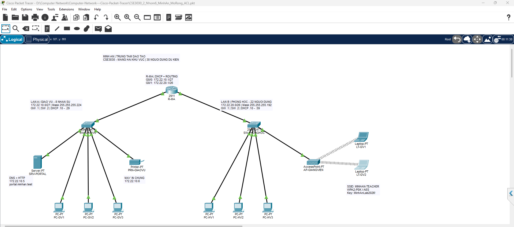

### Sơ đồ nguyên lý (Topology)

```text
                           R-MA (Router 2911)
                       G0/0                  G0/1
                         |                     |
                   SW-GIAOVU              SW-PHONGHOC
                  (Switch 2960)          (Switch 2960)
                   /    |    \              /        \
              3 PC  Server  Máy in       3 PC     AP-GIANGVIEN
                                                    )) ((
                                                  2 Laptop
```

### Danh mục thiết bị

| Thiết bị | Số lượng | Tên trên mô hình / Vai trò |
|---|:---:|---|
| **Router 2911** | 1 | `R-MA`: Gateway 2 LAN, định tuyến liên mạng & DHCP Server |
| **Switch 2960-24TT** | 2 | `SW-GIAOVU`, `SW-PHONGHOC`: Kết nối chuyển mạch Lớp 2 |
| **PC-PT** | 6 | `PC-GV1..3`, `PC-HV1..3`: Máy trạm làm việc của giáo vụ & học viên |
| **Server-PT** | 1 | `SRV-PORTAL`: Máy chủ DNS (`portal.minhan.test`) + Web HTTP |
| **Printer-PT** | 1 | `PRN-GIAOVU`: Máy in mạng dùng chung (`172.22.10.6`) |
| **AccessPoint-PT** | 1 | `AP-GIANGVIEN`: Điểm truy cập Wi-Fi nối vào LAN B |
| **Laptop-PT** | 2 | `LT-GV1`, `LT-GV2`: Laptop giảng viên (card WPC300N) |

Tổng cộng **14 thiết bị** trên Logical Workspace (1 router + 2 switch + 6 PC + 1 server +
1 máy in + 1 access point + 2 laptop). Thành phần *Power Distribution Device* do Packet
Tracer tự sinh trong Physical Workspace không phải một thiết bị mạng và không được tính.

### Bảng kết nối cổng cáp

| Đầu A | Đầu B | Loại cáp |
|---|---|---|
| `R-MA` G0/0 | `SW-GIAOVU` G0/1 | Cáp đồng thẳng (Copper straight-through) |
| `R-MA` G0/1 | `SW-PHONGHOC` G0/1 | Cáp đồng thẳng |
| `SW-GIAOVU` F0/1..3 | `PC-GV1..3` F0 | Cáp đồng thẳng |
| `SW-GIAOVU` F0/4 | `SRV-PORTAL` F0 | Cáp đồng thẳng |
| `SW-GIAOVU` F0/5 | `PRN-GIAOVU` F0 | Cáp đồng thẳng |
| `SW-PHONGHOC` F0/1..3 | `PC-HV1..3` F0 | Cáp đồng thẳng |
| `SW-PHONGHOC` F0/4 | `AP-GIANGVIEN` Port 0 | Cáp đồng thẳng |
| `AP-GIANGVIEN` Port 1 | `LT-GV1, LT-GV2` Wireless0 | Sóng Wi-Fi (WPA2-PSK) |

---

## 4. Kế hoạch địa chỉ IP (IPv4 Subnetting)

| Thông số | LAN A (Khu Giáo vụ) | LAN B (Khu Phòng học) |
|---|---|---|
| **Network Address** | `172.22.10.0/27` | `172.22.20.0/26` |
| **Subnet Mask** | `255.255.255.224` | `255.255.255.192` |
| **Dải IP khả dụng** | `172.22.10.1` - `172.22.10.30` | `172.22.20.1` - `172.22.20.62` |
| **Broadcast Address** | `172.22.10.31` | `172.22.20.63` |
| **Default Gateway** | `172.22.10.1` | `172.22.20.1` |
| **IP Quản trị Switch (VLAN 1)** | `172.22.10.2` | `172.22.20.2` |
| **Dải cấp DHCP** | `172.22.10.10` - `172.22.10.29` | `172.22.20.10` - `172.22.20.59` |
| **DNS Server** | `172.22.10.5` | `172.22.10.5` |

**Cấu hình IP Tĩnh:**
* `SRV-PORTAL`: `172.22.10.5/27` (Default Gateway: `172.22.10.1`)
* `PRN-GIAOVU`: `172.22.10.6/27` (Default Gateway: `172.22.10.1`)

---

## 5. Dịch vụ mạng & Cấu hình

* **DHCP Service:** Cấu hình trên Router `R-MA` với 2 pool `GIAOVU` và `PHONGHOC`, loại trừ các IP tĩnh và gateway.
* **DNS Service:** Domain Name `portal.minhan.test` trỏ về IP `172.22.10.5`.
* **Web Service (HTTP):** Giao diện thông báo nội bộ và lịch học của trung tâm Minh An.
* **Wi-Fi Giảng viên:** 
  * SSID: `MINHAN-TEACHER`
  * Bảo mật: `WPA2-PSK` (AES)
  * Mật khẩu: `MinhAnLab2026!`
* **Bảo vệ truy cập thiết bị:** `enable secret` và tài khoản `admin` (privilege 15) dạng băm Cisco type 5, `service password-encryption`, `login local` trên console và VTY, kèm banner cảnh báo.
* **Cấu hình Cisco IOS:** Toàn bộ lệnh chi tiết được lưu trong các file:
  * [R-MA.txt](R-MA.txt): Cấu hình Router (Interfaces, DHCP Pools, Services)
  * [SW-GIAOVU.txt](SW-GIAOVU.txt): Cấu hình Switch Giáo vụ
  * [SW-PHONGHOC.txt](SW-PHONGHOC.txt): Cấu hình Switch Phòng học
  * [R-MA_MoRong_ACL.txt](R-MA_MoRong_ACL.txt), [SW-PHONGHOC_MoRong_PortSecurity.txt](SW-PHONGHOC_MoRong_PortSecurity.txt): Cấu hình của bản mở rộng

---

## 6. Kết quả kiểm thử & Minh chứng

| Thao tác kiểm thử | Mục đích | Minh chứng |
|---|---|:---:|
| **DHCP LAN A** | PC-GV1 nhận IP tự động `172.22.10.12/27` | 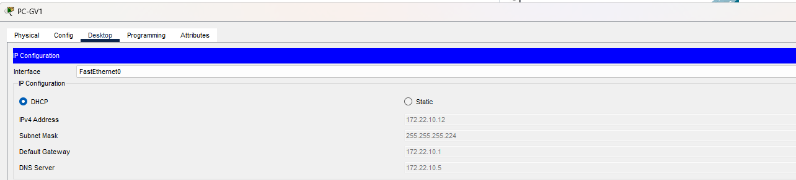 |
| **DHCP LAN B** | PC-HV1 nhận IP tự động `172.22.20.10/26` | 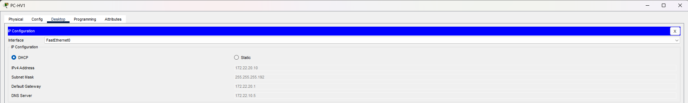 |
| **Router** | `show ip route` + `show ip dhcp binding`: 8 máy, không trùng IP | 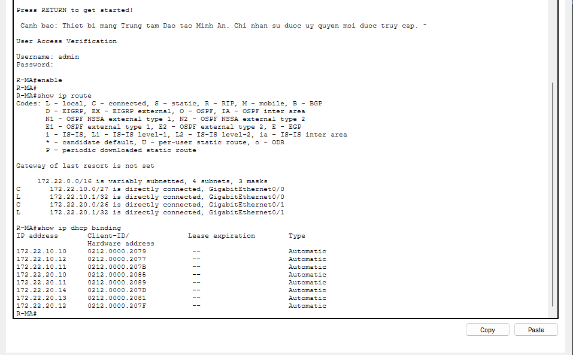 |
| **Web LAN A** | PC-GV1 mở `http://portal.minhan.test` | 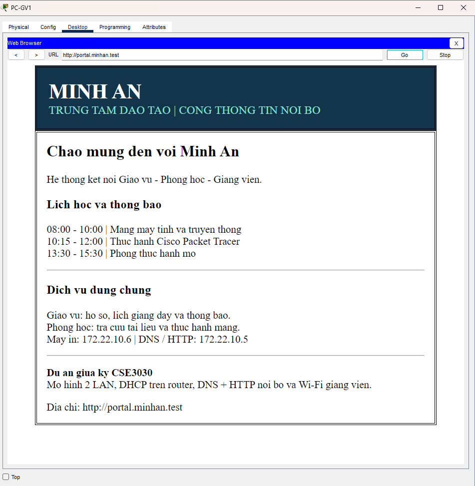 |
| **Web LAN B (dây)** | PC-HV1 mở portal xuyên qua router | 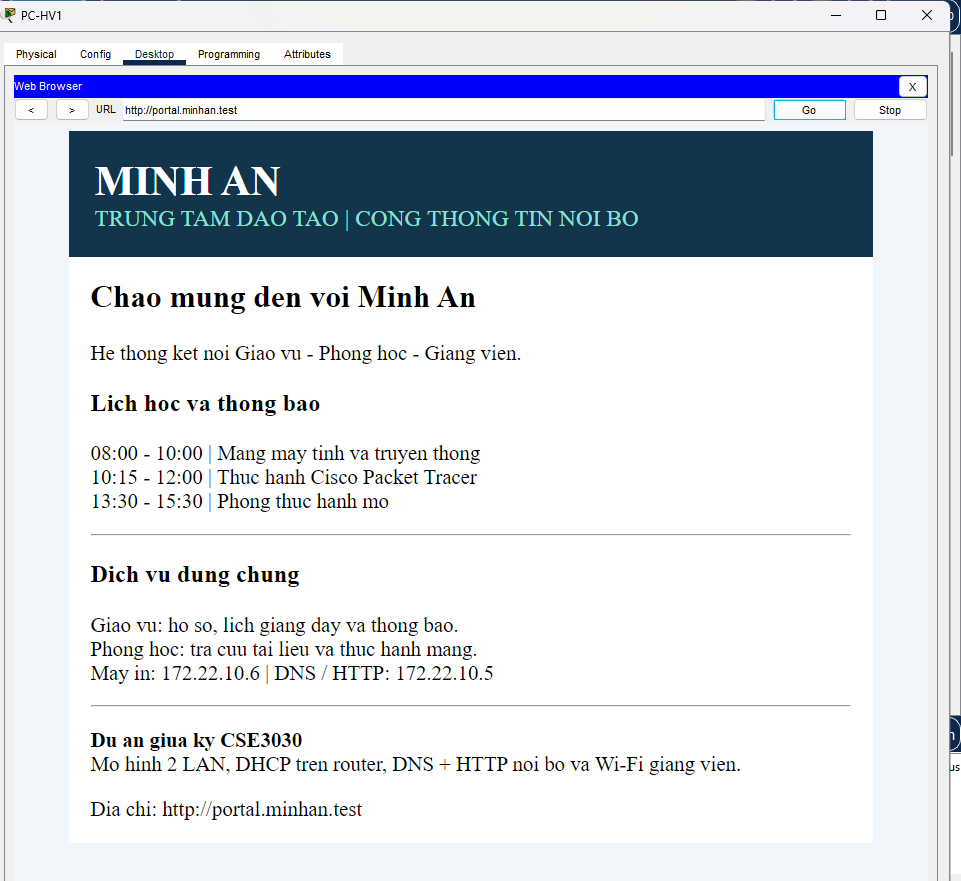 |
| **Wi-Fi** | LT-GV1 nối SSID `MINHAN-TEACHER`, WPA2 | 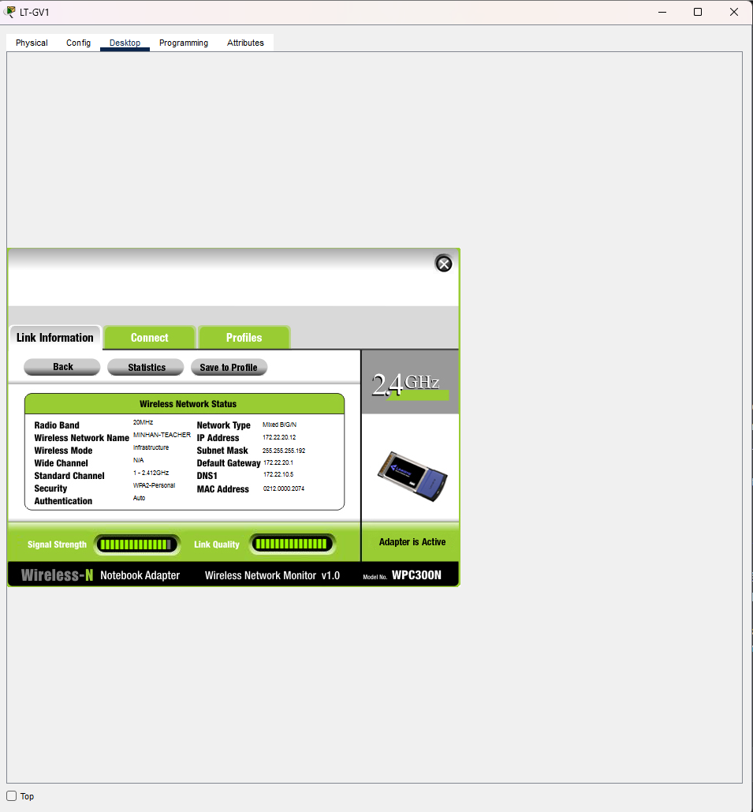 |
| **Web LAN B (Wi-Fi)** | LT-GV1 mở portal qua Wi-Fi | 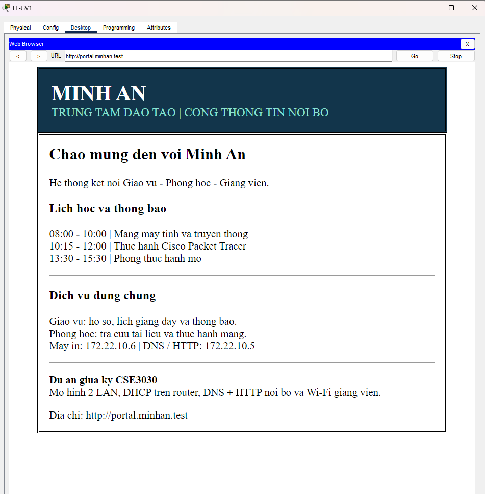 |
| **Máy in** | LT-GV2 (Wi-Fi) ping `172.22.10.6` 4/4 | 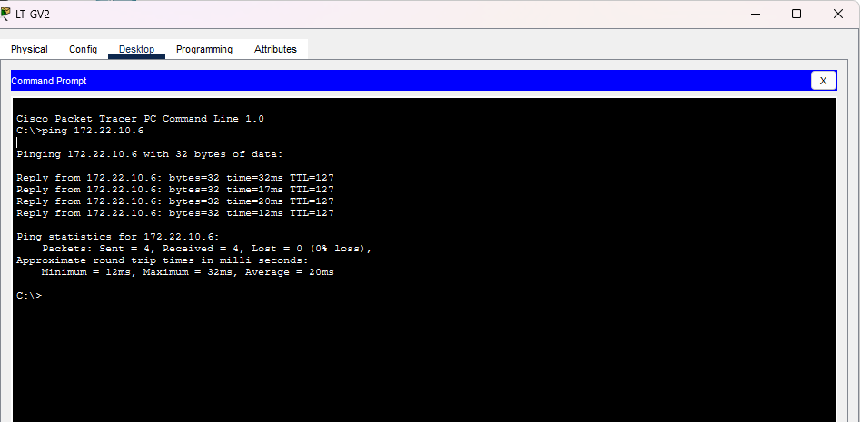 |
| **Simulation** | Gói ICMP PC-GV1 → PC-HV3 đi đúng đường, Successful | 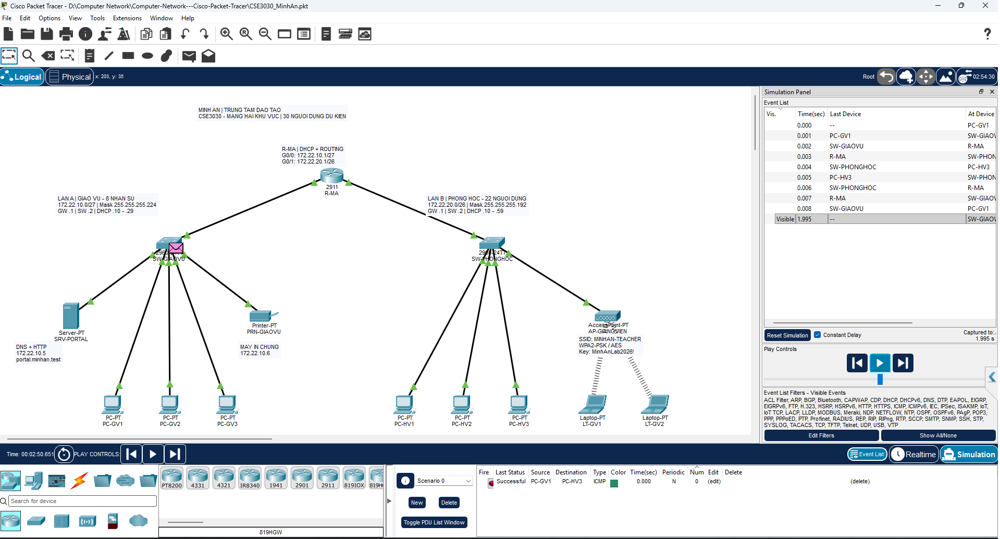 |
| **Bảo vệ thiết bị** | Banner + đăng nhập `admin` trên R-MA | 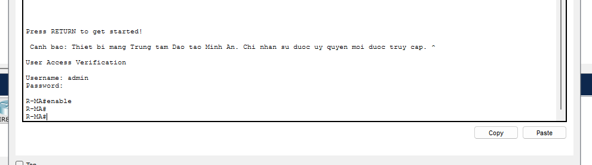 |
| **ACL (mở rộng)** | `show access-lists`: số match của luật cho phép và luật chặn | 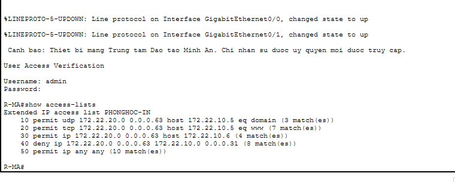 |
| **Port-security (mở rộng)** | SW-PHONGHOC: Enabled, Max 1, Restrict, 3 MAC sticky | 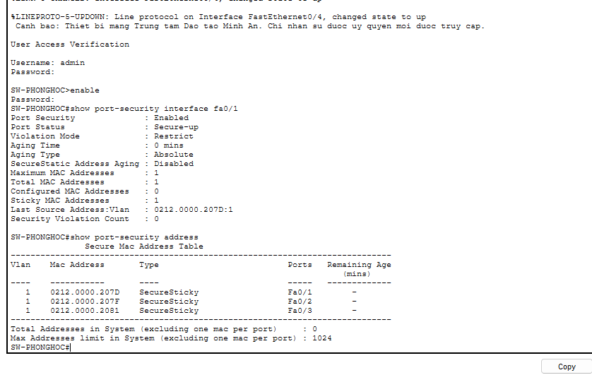 |

Bảng trên là các phép thử **đã có minh chứng ảnh**. Bảng kiểm thử đầy đủ theo đúng mẫu của
đề bài — gồm cả cột *nguồn, đích, thao tác, kết quả mong đợi, kết quả thực tế, minh chứng*,
và các phép thử còn cần chụp bổ sung — nằm trong [`BANG_KIEM_THU.md`](BANG_KIEM_THU.md).

---

## 7. Phần mở rộng tự chọn: ACL

Phương án cơ bản cho phép hai LAN liên lạc tự do với nhau — chia subnet chỉ tách miền quảng
bá, nó không chặn truy cập. Phần mở rộng giải quyết đúng vấn đề đó bằng **ACL mở rộng** đặt
trên cổng router hướng về khu Phòng học:

| Từ khu Phòng học | Kết quả |
|---|---|
| DNS + HTTP tới `SRV-PORTAL` | Cho phép |
| Mọi giao thức tới máy in `172.22.10.6` | Cho phép |
| `ping` tới `SRV-PORTAL` | **Chặn** — ACL lọc theo dịch vụ ở tầng 4, không chỉ theo địa chỉ |
| Truy cập các PC khu Giáo vụ | **Chặn** |
| Chiều Giáo vụ → Phòng học | Không giới hạn |

Kèm theo là **port-security** trên ba cổng nối PC của `SW-PHONGHOC` (không áp cho cổng nối
Access Point, vì mọi laptop Wi-Fi đều gửi khung qua cổng đó).

Thiết kế, giải thích từng dòng lệnh và bảng kiểm thử riêng: [`MO_RONG_ACL.md`](MO_RONG_ACL.md).
File mô phỏng: `CSE3030_2_Nhom6_MinhAn_MoRong_ACL.pkt`.

---

## 8. Hướng dẫn sử dụng file mô phỏng

1. Mở file `CSE3030_2_Nhom6_MinhAn.pkt` bằng **Cisco Packet Tracer (v9.0 trở lên)**.
2. Đợi 10 - 20 giây (hoặc bấm nút **Fast Forward Time**) để quá trình hội tụ Spanning-Tree, kết nối Wi-Fi và xin cấp phát DHCP hoàn tất (tất cả các đèn chuyển sang màu xanh lá).
3. Mở bất kỳ PC hoặc Laptop nào, vào thẻ **Desktop > Web Browser**, gõ địa chỉ:
   ```text
   http://portal.minhan.test
   ```
4. Vào **Command Prompt** của thiết bị để thực hiện kiểm tra ping:
   ```bash
   ping 172.22.10.6    # Ping máy in
   ping 172.22.10.5    # Ping server
   ```
5. Mở tab **CLI** của router/switch sẽ phải đăng nhập: `admin` / `MinhAn@Admin26`, sau đó `enable` với `MinhAn@Enable26`.

Hướng dẫn đầy đủ kèm **kịch bản demo 8 bước**, câu trả lời cho các câu hỏi giảng viên hay hỏi
và bảng xử lý sự cố: [`HUONG_DAN_SU_DUNG_VA_DEMO.md`](HUONG_DAN_SU_DUNG_VA_DEMO.md).

---

## 9. Còn lại trước khi nộp

- [ ] Điền mã lớp, số nhóm, tên thành viên và **bảng phân công công việc**.
- [x] Đổi tên file `.pkt` theo quy ước của lớp (lớp 2, nhóm 6): `CSE3030_2_Nhom6_MinhAn.pkt`.
- [ ] Chụp bổ sung các phép thử còn trống trong [`BANG_KIEM_THU.md`](BANG_KIEM_THU.md)
      và bảng E1–E8 của [`MO_RONG_ACL.md`](MO_RONG_ACL.md).
- [ ] Xác nhận phiên bản Packet Tracer giảng viên dùng (bản này lưu bằng 9.0.1.0858).
